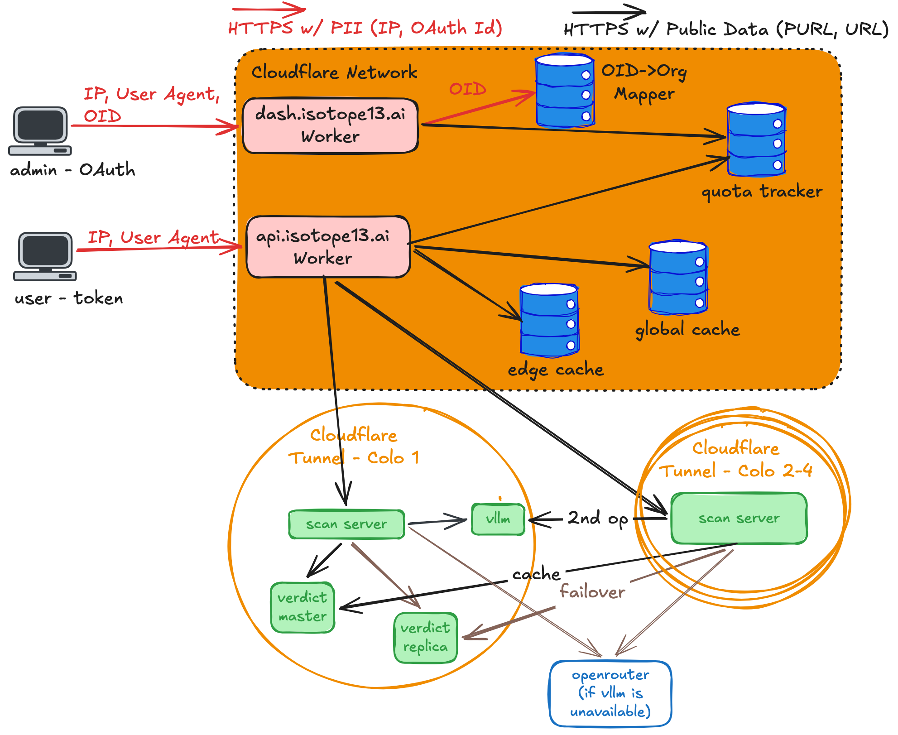

# API Architecture

Nothing that identifies a user reaches our servers. It leaves Cloudflare only for sign-in and billing.

## Scope

We tell customers whether a package, URL, file, or hash is hostile. Our commitments are in our [Terms](../legal/TERMS.md), [SLA](../legal/SLA.md), [Security Measures](README.md), and [DPA](../legal/DPA.md).

Everything below is in scope. Our marketing website and the collectors that feed our dataset are not.

## Components

Each `atomdrift.com` host is a commercial alias of its `atomdrift.org` counterpart.

**Cloudflare Workers:**

- `console.atomdrift.com`: customer accounts. OAuth sign-in; mints API tokens.
- `api.atomdrift.com`: is this PURL, URL, hash, or file hostile? A bearer token resolves to an org for quota.
- `updates.atomdrift.org`: detection rule updates. A bearer token picks the customer's channel.

**Cloudflare storage:**

- OID→Org mapper (Workers KV): OAuth subject identifiers, orgs, tokens. Only console reads identities.
- Quota tracker (Analytics Engine): request counts per org.
- Edge cache (Workers Cache) and global cache (Workers KV): verdicts.
- Rules bucket (R2): detection rules.

**Scan servers** run in our US colos.

**Verdict master** stores artifacts on disk and verdicts in PostgreSQL, with a replica.

**Our LLM** grades borderline results from the scanner's evidence, never the file or the caller. OpenRouter is the fallback.

## Data

Everything we hold. Uploads and verdicts are public; the rest is customer data.

| Data | Personal? | Where it goes |
| --- | --- | --- |
| IP address, user agent | Yes | Cloudflare edge only; never logged |
| OAuth subject identifier, username or email | Yes | console and its KV; the sign-in provider |
| Name, email, address, card | Yes | Stripe |
| API tokens | No | OID→Org mapper |
| Org ID, request counts | No | Quota tracker |
| Request logs | No | Cloudflare, 7 days |
| PURLs, URLs, hashes, files, verdicts | Rarely, inside a file; public | Caches, scan servers, verdict store |

## Trust boundaries

1. Internet → Cloudflare: TLS; OAuth for console, bearer token for the API.
2. Cloudflare → colos, and colo → colo: Cloudflare Tunnel public hostnames, bearer token. No inbound ports.
3. Colos → OpenRouter: TLS, API key.

## Customer responsibilities

- Protect your API tokens, and rotate them when someone leaves.
- Remove departing teammates in the dashboard. Removing them only at your sign-in provider may not end their access.
- Require MFA at your sign-in provider.

## Provider responsibilities

| Provider | We rely on it for |
| --- | --- |
| Cloudflare | Edge TLS, DDoS protection, encryption at rest, and log integrity |
| Hosting providers | Physical security, power, and network |
| Sign-in providers | Signing in your team |
| GitHub | Hosting our code: only code merged there deploys |
| Stripe | Card data, under PCI DSS |
